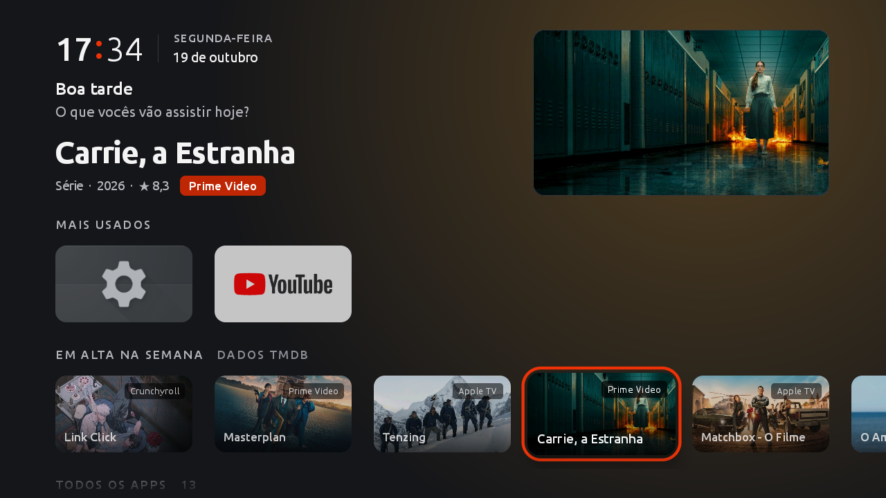

# Início Simples

Tela inicial leve para Android TV / Google TV: sem anúncios, sem recomendação patrocinada, sem serviço em segundo plano. Só um relógio, uma saudação, uma vitrine do item em foco, uma fileira opcional com o que está em alta nos seus apps de streaming e a grade com todos os apps.

Feita para uma Philips 2K com Google TV (Android 11), mas roda em qualquer Android TV com Android 8 ou mais novo.

## Como é



- **Vitrine:** o app em foco aparece grande no topo (nome + banner), e o fundo ganha um brilho com a cor dominante do banner.
- **Relógio de mostrador:** hora, dois-pontos em ember, minuto leve, dia da semana e data.
- **Saudação** que muda com a hora (bom dia / boa tarde / boa noite), com nomes opcionais.
- **Em alta na semana** (opcional): filmes e séries em alta no [TMDB](https://www.themoviedb.org/) que estão nos apps de streaming instalados na TV. OK abre o app certo. Veja [abaixo](#em-alta-na-semana-tmdb).
- **Grade 16:9** em ordem alfabética, com "Mais usados" no topo assim que você começa a abrir apps. O cartão em foco cresce e ganha um anel ember.
- **Rolagem por fileira:** a grade só para em fileira inteira, nunca corta um cartão embaixo da vitrine.
- Fonte Ubuntu, movimento curto (150–320 ms, expo-out) e só quando o foco muda.

Tudo em Java puro, um punhado de arquivos, sem Gradle, sem AndroidX, sem dependências.

## Compilar

Precisa do Android SDK (build-tools + uma plataforma ≥ 30) e de um JDK 17.

```bash
cd launcher
ANDROID_HOME=~/Android/Sdk JAVA_HOME=/caminho/do/jdk-17 ./build.sh
```

Na primeira vez o `build.sh` cria uma chave de assinatura `chave.jks` (e avisa). **Guarde essa chave, de preferência com uma cópia fora do computador.** O Android só instala uma versão nova por cima da antiga se as duas tiverem a mesma chave. Com outra chave, `adb install -r` falha com `INSTALL_FAILED_UPDATE_INCOMPATIBLE`. Aí o único caminho é desinstalar o Início Simples, e com o launcher do Google desativado a TV cai na tela de emergência do sistema até você instalar de novo.

Em outro clone ou outra máquina, aponte para a chave que a TV já conhece:

```bash
KEYSTORE=/caminho/da/chave.jks ./build.sh
```

## Instalar e definir como tela inicial

Na TV: Configurações → Sistema → Sobre → clique 7× no item de build do sistema → em Opções do desenvolvedor, ative a depuração USB (e a depuração por rede, se houver).

```bash
adb connect IP_DA_TV:5555            # aceite o aviso na TV
./scripts/backup.sh IP_DA_TV:5555    # ANTES de mexer em qualquer coisa
adb install -r launcher/tela-inicial.apk
adb shell cmd package set-home-activity --user 0 br.simples.home/.Home
```

### Google TV: por que só isso não basta

O launcher do Google TV (`com.google.android.apps.tv.launcherx`) declara prioridade 2 no filtro HOME. O Android só consulta a tela inicial preferida quando as candidatas têm a mesma prioridade, então ele sempre vence. O segundo da fila é o assistente de configuração (`com.google.android.tungsten.setupwraith`, prioridade 1), cuja tela de "recuperação" religa o launcher do Google.

Para o Início Simples assumir, desative os dois, nessa ordem:

```bash
adb shell pm disable-user --user 0 com.google.android.tungsten.setupwraith
adb shell pm disable-user --user 0 com.google.android.apps.tv.launcherx
adb shell input keyevent KEYCODE_HOME
```

Nada é desinstalado: `pm disable-user` só desativa, e o `restaurar.sh` desfaz.

## Nomes na saudação

Os nomes ficam salvos no aparelho, não no código:

```bash
adb shell am start -n br.simples.home/.Home --es nomes "'Ana e Beto'"   # "Boa noite, Ana e Beto"
adb shell am start -n br.simples.home/.Home --es nomes "''"             # volta a só "Boa noite"
```

## Em alta na semana (TMDB)

Opcional e desligada por padrão: sem chave, o app não abre nenhuma conexão.

1. Crie uma conta grátis em [themoviedb.org](https://www.themoviedb.org/signup).
2. Em Configurações → API, peça uma chave de uso pessoal e copie a **Chave da API** (32 caracteres, não o token de leitura).
3. Mande a chave para a TV. Ela fica salva só no aparelho:

```bash
adb shell am start -n br.simples.home/.Home --es tmdb "'SUA_CHAVE'"
adb shell am start -n br.simples.home/.Home --es tmdb "''"     # desliga e esconde a fileira
```

Como funciona:

- Busca `trending/all/week` em português e, para cada título, onde ele está **incluso na assinatura no Brasil**. Só entra o que está em um app instalado: Prime Video, Globoplay, HBO Max, Apple TV, Crunchyroll, Netflix ou Disney+. Desativou um app, os títulos dele somem.
- Atualiza no máximo a cada 6 horas, numa thread separada. A lista e as imagens ficam guardadas na TV, então a fileira aparece na hora ao ligar, mesmo sem internet.
- OK abre o app onde o título está e mostra o nome dele para você buscar. Os apps de streaming não aceitam link direto para um título de forma confiável.

## Leveza em números

Medido na própria TV (Philips 2K com Google TV, Android 11, **1,5 GB de RAM**) em 19/10/2026:

| | Google TV (original) | Início Simples |
|---|---|---|
| Tamanho do app da tela inicial | 23,9 MB | **0,7 MB** (34× menor) |
| Pacotes ativos | 126 | **110** (17 desativados, nenhum desinstalado, +1 Início Simples) |
| Memória da tela inicial (PSS) | não medida | **44 MB**, já com as 15 imagens da fileira "Em alta" |
| Anúncios e banners patrocinados | sim | nenhum |

Com o Início Simples a TV fica com cerca de 550 MB de RAM livre e 304 processos rodando. Não medimos a tela do Google rodando, porque isso exige restaurar a TV inteira. Se fizer essa medição, abra um PR com o número.

## Limpeza opcional

O que foi desativado na Philips/KTC com Google TV, um `pm disable-user --user 0 <pacote>` por vez. Nunca desinstale app de sistema.

| Categoria | Pacotes |
|---|---|
| Telemetria | `com.google.android.feedback`, `com.google.android.partnersetup` |
| Anúncios / recomendações | `com.realtek.leanbacklauncher.partnercustomizer` |
| Serviços pouco usados | `com.realtek.storemode` (modo loja), `com.vewd.core.service`, `com.hk.gingaplayer.huangs` (Ginga), `com.google.android.play.games`, `com.android.printspooler`, `com.kgzn.serialport` (teste de fábrica), `com.electronic.manual` |
| Depende de você | `com.google.android.apps.mediashell` (Chromecast), `com.google.android.katniss` (Assistente), `com.realtek.miracast`, `com.rtk.mediabrowser` (player de pendrive), apps de streaming |

Não mexa em `com.google.android.gms` (atualização do sistema vem por ele) nem nas entradas de TV da Realtek (`com.realtek.tv.*`, `com.realtek.dtv`). No Brasil a antena usa `com.realtek.tv.isdb`.

## Desfazer tudo

```bash
./scripts/restaurar.sh backup-AAAA-MM-DD IP_DA_TV:5555
```

Reativa todo app que estava ativo no backup e devolve a tela inicial do Google TV. Para reativar um app só:

```bash
adb shell pm enable --user 0 <pacote>
adb shell pm list packages -d    # lista os desativados
```

## Licenças

A fonte Ubuntu é distribuída sob a [Ubuntu Font Licence 1.0](launcher/assets/fonts/UFL.txt).

Este produto usa a API do TMDB, mas não é endossado nem certificado pelo TMDB. Títulos, imagens e disponibilidade vêm do [TMDB](https://www.themoviedb.org/) e do JustWatch.
